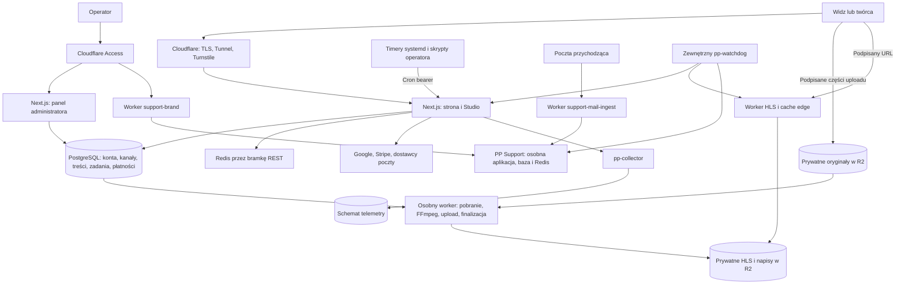

# Mapa systemu Polutek — etap 0/1

Data: 1 listopada 2026. Kod aplikacji: `c397b9e548ca2c628e21457ac69d66e54b12ddbd`. Odczytano checkout gałęzi badawczej na `eb0da3fe8f7bc2d573abacddf474da2c552e8c42`; zmiany od bazy aplikacji dotyczą dokumentacji badania i instrukcji agentów. Nie odczytywano konfiguracji produkcyjnej ani wartości sekretów.

**Status:** mapa źródeł i granic, nie zakończony audyt. Obecność zabezpieczenia w imporcie lub nazwa `requireAdmin` nie oznacza, że działa ono na każdej ścieżce.

## 1. Co należy do systemu

Polutek to więcej niż aplikacja Next.js. Do zakresu należą dwie aplikacje WWW, własny proces kodowania, osobny kolektor statystyk, cztery workery Cloudflare, procesy hosta oraz zewnętrzne usługi tożsamości, płatności, poczty i magazynu. PP Support jest osobnym wdrażanym produktem z własną bazą i Redis; repo zawiera jego konfigurację i nadpisania, a nie cały kod obrazu.



Diagram odwzorowuje intencję konfiguracji i kodu; nie potwierdza aktywnych połączeń, aktualnych DNS ani stanu produkcji. Część zależności jest opcjonalna lub warunkowa.

## 2. Inwentarz powierzchni

Wygenerowano [pełny wynik AST](evidence/system-map.json) i [rejestr punktów do sprawdzenia](POWIERZCHNIA-WEJSC.csv). Generator: [build-system-map.mjs](tools/build-system-map.mjs), uruchamiany z korzenia repo po przygotowaniu zależności:

```bash
node docs/audit/2026-11-01-platform-research/program-audytu/tools/build-system-map.mjs
```

| Element | Wynik | Granica interpretacji |
|---|---:|---|
| Pliki tras Next | 113 | 96 strona/Studio, 17 panel; to pliki, nie wszystkie adresy frameworka |
| Jawne eksporty metod HTTP | 147 | 125 strona/Studio, 22 panel; automatyczne HEAD/OPTIONS nie są doliczane |
| Server Actions | 46 | W 9 plikach panelu; również wymagają autoryzacji i walidacji |
| Pliki stron | 54 | 26 strona, 28 panel; aliasy, locale i rewrite zmieniają widoczne adresy |
| Layouty | 4 | Dodatkowe miejsce egzekwowania sesji, roli i polityki odpowiedzi |
| Moduły z publicznym `index.ts` | 31 | Oprócz nich jest `lib/modules/shared` i kod poza `lib/modules` |
| Workery Cloudflare | 4 | Łącznie 5 handlerów zdarzeń: fetch, scheduled lub email |
| Usługa z `services/*/src/main.ts` | 1 | pp-collector; ma też wewnętrzne HTTP poza Next routes |
| Konfiguracje timerów systemd | 15 | Nie jest to dowód, że wszystkie są zainstalowane lub uruchomione |
| Pliki `scripts/ops/actions` | 10 | Obejmują helpery, nie 10 niezależnych poleceń biznesowych |
| Modele Prisma / enumy | 71 / 37 | Nie obejmują wprost wszystkich tabel telemetry i zewnętrznego PP Support |
| Migracje SQL | 81 | Historia schematu, nie liczba aktualnych tabel |
| Statyczne nazwy `process.env` | 88 | Bez wartości; nie obejmują wszystkich odwołań pośrednich i bindingów workerów |

CSV ma 279 rekordów: 147 metod tras, 46 akcji, 54 stron, 5 zdarzeń workerów, 2 endpointy kolektora, 15 timerów i 10 plików operatora. Crony są już częścią tras HTTP — nie sumujemy ich drugi raz.

**Ograniczenia ekstrakcji:** Better Auth ma catch-all, a Next generuje własne transporty Server Actions. Nazwy wywołań są odczytem składni, nie analizą wszystkich możliwych wykonań. Obraz PP Support i infrastruktura dostawców nie są zinwentaryzowane tym parserem. Zero diagnostyk parsera oznacza jedynie poprawne odczytanie składni przez parser TypeScript; nie jest typecheck ani testem aplikacji.

## 3. Mapa modułów i odpowiedzialności

| Rodzina | Moduły / kod | Co chronimy |
|---|---|---|
| Tożsamość i uprawnienia | `lib/auth`, `lib/api/auth`, `authz`, `users`, osobne `apps/admin/lib/auth` | Konta, sesje, role, odzyskiwanie, tożsamość pracownika |
| Kanały i treści | `channel`, `video`, `playlists`, `translations` | Własność kanału, statusy, publikacja, metadane i członkostwo |
| Multimedia | `video-pipeline`, `media`, `playback`, `access`, `scripts/hls` | Oryginał, wyniki, decyzja dostępu i wydany link |
| Interakcje | `comments`, `subscriptions`, `notifications`, `favorites`, `watch-progress` | Prywatny stan widza, działania twórcy, moderacja i fan-out |
| Pieniądze | `payments`, `patron`, `patron-zone`, `sales` | Oddzielne modele napiwku, dostępu i przyszłej sprzedaży; patrz raport D01 |
| Poczta | `email`, `lib/auth/emails`, transporty i webhooki dostawców | Linki weryfikacji, zmiany konta, wysyłki, zgody i suppression |
| Dane i obserwowalność | `privacy`, `creator-analytics`, `audit`, `health`, `lib/telemetry`, `services/pp-collector` | Minimalizacja danych, pomiary i ślad operacji |
| Odczyty panelu | `admin-analytics`, `admin-community`, `admin-content`, `admin-overview`, `admin-revenue`, `admin-security` | Dane operatora i kontrolowane operacje platformy |
| Wspólne i odkrywanie | `shared`, `syndication`, `lib/i18n`, routing, middleware | Kontekst aktora, transakcje, kolejka trwała, RSS/oEmbed i języki |

To mapa właścicieli przeglądu. Nie oznacza, że ograniczenia importów lub autoryzacja wszystkich operacji zostały już potwierdzone.

## 4. Role nie są jedną listą

1. **Aktor aplikacji:** guest, user, admin, system — `lib/modules/shared/actor.ts`.
2. **Principal uprawnień:** guest, user, staff, system — `authz/domain/principal.ts`. `admin` aktora mapuje się na staff; nie oznacza automatycznie właściciela kanału.
3. **Role kanału:** OWNER, MANAGER, EDITOR, MODERATOR, TRANSLATOR — `authz/domain/matrix.ts`. Wymagają kontekstu konkretnego kanału i jego stanu.
4. **Role konta panelu:** OWNER i TRANSLATOR oraz ograniczenia językowe — `apps/admin/lib/auth/roles.ts`, `access-session.ts`. To inna tożsamość niż zwykłe konto WWW.
5. **Legacy `User.role=ADMIN`:** może dawać aktora admin na WWW. Studio celowo buduje zwykłego aktora user nawet dla tego konta — `lib/api/studio-session.ts`.
6. **System:** worker i cron. Jest to wewnętrzny poziom zaufania; musimy potwierdzić, że dane przeglądarki nie mogą go nadać.

Źródła do dalszego przeglądu: [policy](https://github.com/pawelekbyra/polutek-pl/blob/c397b9e548ca2c628e21457ac69d66e54b12ddbd/lib/modules/authz/domain/policy.ts), [matrix](https://github.com/pawelekbyra/polutek-pl/blob/c397b9e548ca2c628e21457ac69d66e54b12ddbd/lib/modules/authz/domain/matrix.ts), [Studio session](https://github.com/pawelekbyra/polutek-pl/blob/c397b9e548ca2c628e21457ac69d66e54b12ddbd/lib/api/studio-session.ts), [panel Access](https://github.com/pawelekbyra/polutek-pl/blob/c397b9e548ca2c628e21457ac69d66e54b12ddbd/apps/admin/lib/auth/access-session.ts).

**Konsekwencja dla testów:** samo „test admina” jest nieprecyzyjne. Trzeba wskazać rodzaj konta, kanał, rolę, onboarding, status kanału/filmu, sposób logowania i świeżość potwierdzenia.

## 5. Przepływy krytyczne

| ID | Przepływ i punkty kodu | Obietnica do zweryfikowania | Powiązanie bazowe |
|---|---|---|---|
| F01 | Rejestracja/logowanie → `app/api/auth/[...all]` → `lib/auth` → Prisma + captcha/Google/poczta | Tożsamość nie jest nadawana przez dane klienta; odzyskiwanie nie omija zabezpieczeń | R13–R15 |
| F02 | Studio → `withStudio` → własne członkostwa → autoryzowany use case | Kanał A nie może czytać/mutować zasobów B; rola jest sprawdzana również po stronie backendu | Zakres D04 |
| F03 | Upload → podpisy części → bezpośredni R2 → complete i weryfikacja → enqueue | Można wznowić, koszt jest ograniczony, zmieniony stan uprawnień jest respektowany | R06, R15, R22 |
| F04 | Claim → pobranie → FFmpeg → upload → finalizer → aktywna trasa | Jedna próba nie niszczy wyniku innej; częściowy wynik nie staje się gotowym filmem | R02–R04 |
| F05 | Publikacja → zmiana statusu → powiadomienie → DurableJob → odbiorcy | Film i zamiar ogłoszenia nie rozjeżdżają się po awarii; fan-out nie dubluje odbiorców | R05 |
| F06 | Plan odtwarzania → decyzja dostępu → token → Worker → R2/cache | Gość nie dostaje chronionego filmu; cofnięcie dostępu ma określony czas działania | R07, R18 |
| F07 | Kasa patrona → tryb demo/Stripe → intent → podpis webhooka → fulfillment → grant | Tryb demo nie udaje pobrania pieniędzy; jedna płatność przyznaje właściwy dostęp raz | R17 dla granicy z marketplace |
| F08 | Zwrot w panelu → operator → uzgodnienie → audyt | Powtórzenie, spór i utrata odpowiedzi nie rozjeżdżają pieniędzy z uprawnieniem | D10, R17 |
| F09 | Usunięcie filmu → snapshot w transakcji → STORAGE_CLEANUP → cron → R2 | Po usunięciu z bazy nie ginie informacja, co trzeba usunąć z magazynu | R04, R12 |
| F10 | Komentarz/zgłoszenie → policy → moderacja → audyt/powiadomienie | Stan i autor operacji są prawidłowe, zgłoszenie nie daje nadmiarowych praw | D04/D11 |
| F11 | Beacon → `/api/t` → pp-collector → bufory → telemetry | Dowolny klient nie może nieograniczenie obciążać kolektora ani zatruwać pomiaru | R18, D12/D16 |
| F12 | E-mail → support-mail-ingest → Access service token → PP Support + archiwum | Wiadomość trafia do właściwej skrzynki; dane i awaria mają określony cykl życia | D05/D12/D17 |
| F13 | Backup → zaszyfrowany offsite → restore → baza i wideo | Można odtworzyć działający produkt z danych pozostających po utracie serwera | R12 |
| F14 | Eksport/usuwanie konta → powiązane dane → retencja | Kompletność i czas operacji nie zależą od małej historii jednego konta | R16 |

F01–F14 to katalog scenariuszy, nie czternaście zaliczonych testów. R01–R22 zachowują statusy i dowody z raportu bazowego; mapa nie podnosi automatycznie ich pewności.

## 6. Granice zaufania

| Granica | Dane przekraczające granicę | Co trzeba sprawdzić |
|---|---|---|
| Internet → edge → aplikacja | Nagłówki IP/host/origin, ciasteczka, body | Kto ustawia zaufane nagłówki i czy origin jest dostępny z pominięciem edge |
| Przeglądarka → API/Server Action | ID użytkownika/kanału/filmu i żądana operacja | Sesja, rola, własność, CSRF, rozmiar, stan obiektu i limit |
| Kanał A → zasób kanału B | ID oraz pola zagnieżdżone, eksport, statystyki | Izolacja nie może polegać na ukrytym przycisku lub samym wyborze kanału |
| Access → panel → use case | Zweryfikowany JWT i ograniczenia roli/języka | Podpis, issuer/audience, czas, tożsamość i sprawdzenie wrażliwej akcji |
| Aplikacja → podpisany URL → R2 | Uprawnienie do wysyłania konkretnej części | Zakres klucza, wygaśnięcie, quota i późniejsza weryfikacja obiektu |
| Baza kolejki → worker → magazyn → publikacja | Dzierżawa zadania i wynik próby | Własność skutków zewnętrznych, nie tylko statusu w bazie |
| Dostawca płatności/poczty → webhook | Zewnętrzne zdarzenie i powtórzenia | Podpis, body, idempotencja, kolejność i uzgodnienie |
| Klient → telemetria → analityka | Niewiarygodne zdarzenia i metadane sieci | Minimalizacja danych, limity, fałszywe zdarzenia i retencja |
| Wiadomość e-mail → skrzynka/obsługa | Treść i załączniki z zewnątrz | Rozmiary, uprawnienia do archiwum, retencja; treść nie jest poleceniem operatora |
| Operator/host → produkcja/backup | Uprawnienia wdrożenia i odzyskiwania | Oddzielne role, sekretów nie ma w raporcie; ścieżka rollback/restore |

## 7. Zależności i tryby awarii do dalszej kwalifikacji

| Zależność | Użycie w kodzie/konfiguracji | Niewiadoma |
|---|---|---|
| PostgreSQL głównej aplikacji | Konta, domena, finanse, kolejki | Rola runtime, pool, limity, utrata połączenia, HA i backup |
| Redis + bramka REST | Rate limiting i blokady pomocnicze | Różne ścieżki fail-open/fail-closed, stan przy skalowaniu |
| Cloudflare Tunnel/Access/Turnstile | Transport, operator, antybot | Aktywna konfiguracja i ścieżki omijające; nie wynika w całości z Git |
| R2 i Worker HLS | Uploady, filmy, miniatury, napisy | Role kluczy, lifecycle, cache/purge, utrata obiektu i rozliczenie kopii |
| Google OAuth / Have I Been Pwned | Warunkowe logowanie i sprawdzanie haseł | Tryb konfiguracji i degradacja; sam brak jawnego sekretu niczego nie rozstrzyga |
| Stripe | Napiwki i kasa patrona; przyszły adapter marketplace | Tryb test/live, webhooki, idempotencja i rzeczywista konfiguracja konta |
| Dostawcy poczty | Resend, SES SMTP, opcjonalne transporty | Dostarczanie, retry, suppression, konfiguracja i zgody |
| PP Support i jego baza/Redis/storage | Oddzielny zewnętrzny produkt, nadpisania w repo | Wersja/digest obrazu, funkcje aktywne, aktualizacje i zakres przeglądu dostawcy |
| D1 i zewnętrzny watchdog | Stan monitorów i alertów | Czy monitor sprawdza obietnicę usługi, a nie tylko kod HTTP |
| Host/systemd/Docker/backup | Wdrożenie, harmonogramy, odtwarzanie | Stan działającej infrastruktury wymaga osobnej kontroli |

Nazwy `queueVerificationEmail` nie należy utożsamiać z trwałą kolejką: `lib/auth/emails.ts` używa uruchomienia Promise bez oczekiwania i loguje błąd. Rozsyłki mają inną kolejkę w Postgresie. Należy zbadać gwarancję dostarczenia dla każdego rodzaju wiadomości osobno, bez ogłaszania na tej podstawie awarii produkcji.

## 8. Otwarte pytania i następna partia

- Jaka jest docelowa mieszanka funkcji i obciążenia, a nie tylko etykieta „duża platforma”? Nie blokuje to przeglądu źródeł.
- Które przełączniki są faktycznie włączone i które funkcje są świadomie zamrożone? Nie odczytywano wartości produkcyjnych.
- Czy kod obrazu PP Support i konfiguracja Cloudflare są w zakresie bezpośredniego audytu, czy weryfikujemy je jako zależności? Nie można ich po prostu zaliczyć na podstawie tego repo.
- Czy wszystkie Server Actions, catch-all auth, operator scripts i zdarzenia mailowe mają scenariusze kontroli tak samo jak zwykłe REST API?
- Jakie dokładnie zachowanie ma mieć brak uprawnień, usunięty zasób, zawieszony kanał, wygasły dostęp i ponowienie operacji?

**Dalej:** D03/D04 — model tożsamości i izolacja kanałów w realnych punktach wejścia. Statyczne wskazówki guardów służą wyłącznie do wyboru kolejności czytania. Pełny runtime nadal jest zablokowany klientem Prisma; nie powtarzano niezmienionych testów z raportu bazowego.
