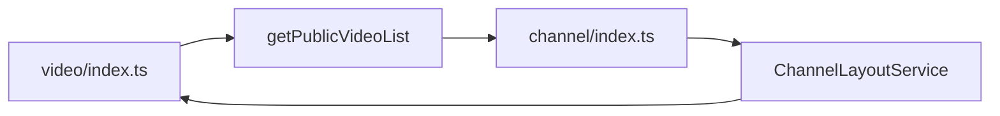

# D02 — architektura i utrzymywalność

Partia 12, 1 listopada 2026. **W_TRAKCIE**. Polutek `c397b9e548ca2c628e21457ac69d66e54b12ddbd`, PeerTube `fa7d2b5d8a44bbec99159b11e91763f7d2308faa`. [Zakres/hash](../evidence/batch12-review.json), [zależności modułów](../ZALEZNOSCI-MODULOW.csv), [17 scenariuszy](../SCENARIUSZE-ARCHITEKTURA.csv), [walidacja materiału](../evidence/validation-batch12.json). Materiały badawcze, bez zmian aplikacji i produkcji. Docelowy bieżący scenariusz: kilkunastu twórców i 10000 równoczesnych widzów w szczycie.

## Ocena dla właściciela

Polutek ma sensowną strukturę **modularnego monolitu**: logika jest grupowana według obszarów produktu, panel ma osobną tożsamość, trasy korzystają z modułów, a część reguł jest czysta i łatwa do sprawdzenia. W projekcie istnieją własne bramki architektury i przykłady dobrego oddzielenia logiki od usług. Nie wynika z tego potrzeba przebudowy na mikroserwisy.

Najważniejszy nowy dług **R34** dotyczy zależności: publiczne wejścia modułów wideo i kanału wzajemnie przyciągają swoje operacje, a kontekst aplikacji inicjalizuje domyślną infrastrukturę jeszcze przed przekazaniem bazy testowej. Utrudnia to izolowanie niewielkich zmian i testów. To potwierdzone sprzężenie strukturalne, **nie wykazana awaria, luka bezpieczeństwa ani zmierzony koszt bundle**.

**R21** ma mocniejszy dowód dotyczący kontraktów klientów. W rzeczywistym kliencie Studia generyczny typ odpowiedzi jest rzutowaniem, a nie sprawdzeniem JSON. Poprawna odpowiedź i błąd 403 działają w próbie kontrolnej, ale syntetyczna zmiana pola przy 200 przechodzi bez błędu kontraktu. Nie wykazano, że działający backend wysyła takie odpowiedzi.

## Co rzeczywiście zbadano

| Warstwa dowodu | Zakres i wynik | Ograniczenie |
|---|---|---|
| Przegląd źródeł | Wybrane fragmenty 52 plików Polutka i 18 PeerTube | Zakres nakłada się na poprzednie partie. Nie są to 52 ani 18 kompletnie zaudytowane pliki |
| [AST/graf](../tools/architecture-graph.cjs), [pełny JSON](../evidence/architecture-graph.json) | Mechanicznie 1701 śledzonych plików TS/TSX z baseline, hashe zgodne, zero diagnostyk parsera; 1133 poza tests/scripts | To nie 1701 przeczytanych plików, typecheck ani całe repo; pliki JS/MJS, CSS, obliczane importy i wnętrza zależności są poza grafem |
| [Próba importów](../evidence/architecture-import-probe.json) | 4 obserwacje rzeczywistego kodu: czysty helper, authz index i AppContext/Prisma wiring | Jawna atrapa samego konstruktora PrismaClient w świeżym VM, bez klienta/engine/DB; nie instalowano jej w aplikacji |
| [Próba bramki](../evidence/architecture-guard-probe.json) | 9 małych syntetycznych drzew plików, rzeczywisty check-architecture.ts | Bez wykonywania autoryzacji lub tras; bada ograniczenia kontroli statycznej |
| [Próba klienta](../evidence/api-contract-probe.json) | 4 obserwacje rzeczywistego studioApi na syntetycznym fetch/Response | Bez rzeczywistego HTTP i dowodu rozbieżności serwera |
| [Istniejący Vitest](../evidence/architecture-targeted-vitest.json) | 3 pliki, **12/12 passed**, globalny exit 0 w tym podzbiorze | Granice email 3, user policy 5, user errors 4; nie pełny zestaw ani odblokowanie Prisma |
| Istniejące bramki | Architektura exit 0; hotspots exit 1 dla czterech plików | Nie uruchomiono pełnego lokalnego CI, typecheck, build ani całej aplikacji |

Łącznie wykonano 12 unikalnych rzeczywistych modułów TS w dwóch eksperymentach VM. Dziewięć prób bramki uruchamia oryginalny skrypt na fixture. Nie zaliczamy tych obserwacji jako pełnych prób HTTP; wszystkie nowe scenariusze mają full_stack_status=NIEWYKONANE.

## Mapa odpowiedzialności i zależności

Graf rozpoznaje **32 katalogi modułów, w tym shared, oraz 31 publicznych index.ts**. Rozróżniono 7888 deklaracji importów/eksportów i 6947 odwołań po lokalnej transpile TypeScript. W grafie po transpile istnieje jedna silnie spójna składowa 77 plików; graf deklaracji wraz z typami ma dwie. Składowa oznacza, że w analizowanym grafie można dojść z każdego jej pliku do pozostałych po zależnościach, nie że wszystkie funkcje wywołują się w jednym żądaniu.

Po zwinięciu plików do modułów jedna składowa obejmuje access, channel, email, media, patron, patron-zone, payments, subscriptions, users i video. Graf modułów może łączyć odwołania z różnych plików; sam nie jest dowodem konkretnego cyklu plików. Poniższy krótki cykl plików został osobno wyprowadzony z krawędzi:

Źródła: [video index](https://github.com/pawelekbyra/polutek-pl/blob/c397b9e548ca2c628e21457ac69d66e54b12ddbd/lib/modules/video/index.ts), [lista wideo](https://github.com/pawelekbyra/polutek-pl/blob/c397b9e548ca2c628e21457ac69d66e54b12ddbd/lib/modules/video/application/get-public-video-list.use-case.ts), [channel index](https://github.com/pawelekbyra/polutek-pl/blob/c397b9e548ca2c628e21457ac69d66e54b12ddbd/lib/modules/channel/index.ts), [layout kanału](https://github.com/pawelekbyra/polutek-pl/blob/c397b9e548ca2c628e21457ac69d66e54b12ddbd/lib/modules/channel/application/channel-layout.service.ts). Layout potrzebuje m.in. czystego compareSidebarItems, ale importuje szerokie wejście video. Oba index mają osiągalność po 269 lokalnych plików, w tym lib/prisma.ts; zakresy nakładają się i nie sumują do 538 niezależnych plików.

### Dlaczego liczby nie są diagnozą awarii

Graf po transpileModule ESNext rozlicza elision typów i literalne zależności, lecz nie zna produkcyjnego tree shaking SWC/Next. Osiągalność 269 plików nie oznacza, że widz pobiera te pliki, że baza otwiera 269 połączeń albo że uruchamiane są wszystkie operacje płatnicze. Nie zmierzono cold start, bundle, pamięci i czasu refaktoryzacji. Nie przeanalizowano grafu wszystkich zależności PeerTube, więc nie twierdzimy, że jest wolny od cykli.

33 nierozwiązane lokalne odwołania mają rozliczenie: 31 to istniejące CSS poza resolverem TypeScript, a dwa — deklaracje wygenerowanego Next w apps/admin/next-env.d.ts. Nie są to 33 odkryte brakujące moduły. Osiem zależności z lib/modules do app/types znika w grafie po transpile, także gdy zapis importu nie zawiera jawnego type. To temat miejsca przechowywania kontraktu, nie wykazany wyciek interfejsu lub sekretów.

Trzy odwołania z domain do @prisma/client dotyczą enumów/DTO/policy. Sam import enuma nie jest połączeniem z bazą. Nie klasyfikujemy automatycznie każdej zależności od ORM jako osobnego defektu.

## R34 — kontekst i publiczne wejścia nie dają pełnej izolacji

[createAppContext](https://github.com/pawelekbyra/polutek-pl/blob/c397b9e548ca2c628e21457ac69d66e54b12ddbd/lib/modules/shared/app-context.ts) przyjmuje aktora, bazę, zegar, kanał i inne dane. Wstrzyknięta baza jest respektowana — to dobra cecha. Jednocześnie moduł importuje defaultPrisma z [lib/prisma.ts](https://github.com/pawelekbyra/polutek-pl/blob/c397b9e548ca2c628e21457ac69d66e54b12ddbd/lib/prisma.ts), który tworzy singleton na poziomie modułu.

[Eksperyment](../tools/architecture-import-probe.cjs) wykonał rzeczywiste pliki w osobnym VM. Jawny konstruktor-probe zewnętrznego PrismaClient odnotował **jedną inicjalizację już przy imporcie AppContext**. Następne createAppContext z testową bazą zachowało tę bazę i nie utworzyło drugiego klienta. Domyślny kontekst użył wcześniej utworzonego singletona. Nie wykonano metod Prisma, SQL, połączenia ani prawdziwego konstruktora biblioteki; sprawdzono kolejność składania zależności.

Kontrole dodatnie: bezpośredni helper video-visibility działał bez konstruktora bazy, a publiczny index authz załadował własne reguły i authorize bez domyślnego Prisma. Nie wszystkie moduły są więc równie sprzężone. Wyjątki CROSS_MODULE_INTERNAL_IMPORT_ALLOWLIST w skrypcie architektury opisują już m.in. cykle i mockowanie szerokich index — dług jest częściowo rozpoznany w samym kodzie.

**Klasyfikacja:** P2 jako dług architektoniczny przed większym rozwojem, niezależny przegląd PENDING. Nie jest to nowa podatność bezpieczeństwa i nie dowód, że obecna witryna nie działa. **R34 po raz pierwszy wpisano do rejestru w tej partii.** Robocze R34 eksportu w initial JSON partii 10 zostało wtedy scalone z R16 i nigdy nie było wpisem rejestru; zachowano ten historyczny plik, nowe R34 ma odrębny temat i dowody.

Kierunek poprawy: wąskie publiczne wejścia dla reguł/kontraktów i osobne dla operacji serwerowych; składanie domyślnego DB/SDK w miejscu uruchamiania aplikacji. Stopniowo rozciąć konkretną pętlę video/channel i objąć uzgodnione zależności kontrolą AST/cykli. Nie wystarczy mechanicznie dopisać index ani globalnie zabronić wszystkich głębokich importów. Odbiór: czyste wejścia działają bez konstruktora infrastruktury, podanie testowego DB nie inicjalizuje domyślnego; krytyczne integracje nadal przechodzą osobne próby.

## Co faktycznie potwierdza zielona bramka

[Oryginalny wynik](../evidence/architecture-guard-batch12.log): zero bezpośrednich importów Prisma i dawnych services w sprawdzanych trasach; 166 plików panelu, 34 sprawdzane pliki use case i 32 jawnie zwolnione. Istnieje przydatna automatyczna ochrona przed prostymi regresjami organizacji kodu. To skan tekstowy importów/markerów, nie analiza przepływu uprawnień.

[Syntetyczne próby](../tools/architecture-guard-probe.py) uruchomiły niezmieniony skrypt w dziewięciu katalogach tymczasowych:

| Próba | Wynik bramki | Interpretacja |
|---|---|---|
| Zwykły dozwolony import modułu | PASS | Dodatnia kontrola |
| Statyczny next/cache w module | FAIL | Zakaz wykryty |
| Dynamiczny import next/cache | PASS | Tego wariantu zapis kontroli nie obejmuje |
| Statyczny import auth strony w panelu | FAIL | Izolacja panelu wykryta dla sprawdzanej składni |
| Dynamiczny import tego samego auth | PASS | Brak pełnej analizy importów |
| Use case bez markera autoryzacji | FAIL | Dodatnia kontrola wykrywania braku |
| Sam komentarz z authorize( | PASS | Marker nie dowodzi wykonania kontroli |
| Składniowe wywołanie authorize | PASS | Bramka widzi marker, nie sprawdza polityki |
| Dwa publiczne index tworzące cykl | PASS | Cykle nie są przedmiotem tej bramki |

Żadna z tych syntetycznych prób nie dowodzi osiągalnego obejścia uprawnień Polutka. Właściwe use case mają rzeczywiste authorize i wcześniej zapisane testy polityk. Poprawa kontroli składni zmniejszy fałszywe poczucie kompletności, ale nadal potrzebne są testy zachowania, także z pełną aplikacją. Nie wyłączamy istniejącej bramki.

## Cztery przekroczenia budżetu plików

[check-hotspots](../evidence/hotspot-guard-batch12.log) zwrócił exit 1:

| Plik | Liczba linii według istniejącego skryptu | Limit |
|---|---:|---:|
| ChannelHome.tsx | 471 | 470, jawny wyjątek |
| PassCheckoutSheet.tsx | 517 | 450 |
| StudioUploadWizard.tsx | 501 | 450 |
| StudioVideoEditor.tsx | 515 | 450 |

Jednolinijkowe przekroczenie ChannelHome samo niewiele mówi o jakości; liczenie przez split uwzględnia też ostatni pusty element po newline. Większe komponenty są kandydatami do przeglądu odpowiedzialności, nie dowodem błędu funkcji. Nie przeprowadzono tu pełnego ręcznego audytu ich zachowania, złożoności ani UX. Nie dodano osobnego problemu dla każdego pliku.

Lokalne CI i uśpiony workflow mają kroki hotspots, a package quality jest krótszą kombinacją architektury, typów i testów. [Dokumentacja lokalnego CI](https://github.com/pawelekbyra/polutek-pl/blob/c397b9e548ca2c628e21457ac69d66e54b12ddbd/docs/operations/LOCAL-CI.md) opisuje szerszy zestaw. Nie wykonano całego CI ani nie stwierdzono, że historyczny merge miał zielony lub czerwony wynik. Świeży pojedynczy hotspot check ma jawnie FAIL i pozostaje bez naprawy w trybie badawczym.

## R21 — kontrakt API i dublowanie klientów

[studioApi](https://github.com/pawelekbyra/polutek-pl/blob/c397b9e548ca2c628e21457ac69d66e54b12ddbd/app/components/studio/studio-client.ts) parsuje JSON, obsługuje błędny status i zwraca body as T. [Uploader panelu](https://github.com/pawelekbyra/polutek-pl/blob/c397b9e548ca2c628e21457ac69d66e54b12ddbd/lib/video-upload/multipart-uploader.ts) ma podobny generyczny helper i lokalne kształty danych, [uploader Studia](https://github.com/pawelekbyra/polutek-pl/blob/c397b9e548ca2c628e21457ac69d66e54b12ddbd/app/components/studio/upload-original.ts) własny StartedUpload. Różne adaptery tras i tożsamości są uzasadnione; wspólna semantyka części, wznowienia i odpowiedzi ma koszt powielania. R22 już opisuje konkretną różnicę wznowienia — nie odkryto jej na nowo.

[Cztery próby](../tools/api-contract-probe.cjs) wykonały rzeczywistą funkcję Studia: poprawny 200 zwrócił originalId, zmieniony originalId→renamedOriginalId przy 200 został zwrócony bez odmowy, nie-JSON przy 200 dał null, a 403 prawidłowo rzucił StudioApiError z kodem FORBIDDEN. To demonstracja braku walidacji schematu na tej granicy, nie dowód wadliwej odpowiedzi serwera, exploit ani pełny test kontraktu.

Kierunek: wspólne request/response najpierw dla upload/job/playback poza UI, wersjonowany kontrakt i test prawdziwej odpowiedzi. Wspólny silnik uploadu z osobnymi adapterami zachowuje zasady uprawnień. Nie trzeba od razu tworzyć publicznego SDK dla zewnętrznych klientów. Odbiór: istotna rozbieżność pola/statusu/JSON wykrywana przed wdrożeniem, a nie tylko przez ręczny test użytkownika.

## Co warto zachować z Polutka

- Osobny auth panelu i reguły importów: realna granica odpowiedzialności, częściowo sprawdzana automatycznie.
- Czysta polityka authz i helper widoczności: kontrole importu bez domyślnej bazy, łatwy punkt do testów.
- AppContext już przekazuje aktora, kanał, zegar i DB. Wymaga rozdzielenia inicjalizacji, nie odrzucenia idei kontekstu.
- [DurableJobStore](https://github.com/pawelekbyra/polutek-pl/blob/c397b9e548ca2c628e21457ac69d66e54b12ddbd/lib/modules/shared/durable-job.ts) i osobne repozytorium pokazują lokalny przykład portu oddzielającego runner od ORM. Nie zaliczono ponownie całej poprawności kolejki.
- strict=true jest zadeklarowane w konfiguracji TypeScript. R09 i blokada wygenerowanego Prisma nadal wymagają faktycznego egzekwowania kontroli; deklaracja nie zastępuje wyniku.

## Konkretne porównanie z PeerTube

W tej partii częściowo przeczytano 18 wskazanych źródeł; [lista/hash](../evidence/batch12-review.json). PeerTube nie instalowano ani nie uruchamiano. Porównanie nie jest oceną wszystkich modułów i nie obejmuje równego grafu zależności obu repozytoriów.

| Temat | Wzorzec PeerTube | Wniosek i ograniczenie |
|---|---|---|
| Typy API | [packages/models](https://github.com/Chocobozzz/PeerTube/blob/fa7d2b5d8a44bbec99159b11e91763f7d2308faa/packages/models/package.json) i Video/VideoCreate poza komponentami, odrębny pakiet bez zadeklarowanych zależności runtime | Warto uporządkować kontrakty Polutka podobną granicą. Typy interfejsów same nie walidują JSON |
| Czyste narzędzia | Osobny core-utils, deklarowane exports i brak dependencies | Nazwana granica współdzielenia; szeroki index też istnieje, więc nie sam index jest błędem |
| Budowa pakietów | [TS references](https://github.com/Chocobozzz/PeerTube/blob/fa7d2b5d8a44bbec99159b11e91763f7d2308faa/server/tsconfig.json), odrębne katalogi wyjściowe i aliasy | Jawniejsza granica serwera i pakietów; więcej konfiguracji i zależności budowy, nie automatyczna potrzeba monorepo packages dla małego zespołu |
| API/spec | OpenAPI 3.0.3, wspólne modele, [krok walidacji specyfikacji](https://github.com/Chocobozzz/PeerTube/blob/fa7d2b5d8a44bbec99159b11e91763f7d2308faa/scripts/ci.sh#L258) | Przydatny kontrakt dla większej liczby klientów; nie potwierdzono automatycznej zgodności runtime z OpenAPI |
| Dokumentowanie operacji | [openapiOperationDoc](https://github.com/Chocobozzz/PeerTube/blob/fa7d2b5d8a44bbec99159b11e91763f7d2308faa/server/core/middlewares/doc.ts) ustawia docUrl | Link do dokumentacji nie sprawdza response body |
| Klient testowy | VideosCommand korzysta ze wspólnych modeli i oczekiwanego statusu | To użyteczna warstwa testowania HTTP; nadal widoczne są generyczne typy odpowiedzi, nie certyfikat zgodności schematu |
| Wzorzec backendu | Controllers importują modele i duże index; Sequelize associations mają osobne M... typy | PeerTube nie jest czystym wzorcem architektury portów. Nie mamy dowodu braku cykli lub lepszej izolacji wszystkich usług |
| Typy | Bazowe strict=false i noImplicitAny=false, przy innych włączonych kontrolach | Polutek ma ostrzejszą deklarację strict=true. Większy projekt nie ma automatycznie lepszej dyscypliny każdego ustawienia |

[Poradnik serwera](https://github.com/Chocobozzz/PeerTube/blob/fa7d2b5d8a44bbec99159b11e91763f7d2308faa/support/doc/development/server.md) opisuje zmianę funkcji przez konfigurację, walidator, model, wspólne typy, komendy/testy i specyfikację. To dobry wzorzec kompletności zmiany; część wskazanych ścieżek testów jest historyczna względem obecnego packages/tests. Nie wykonano tego workflow. Nie kopiowano implementacji.

## K04 — częściowa realizacja, 6 listopada 2026

W `channel-layout.service.ts` zastąpiono szeroki import `@/lib/modules/video` nowym czystym wejściem `@/lib/modules/video/pure.ts`, które eksportuje wyłącznie `compareSidebarItems`. To rozcina wskazaną pętlę `video → channel → channel-layout → video barrel` dla tego helpera; nie jest to przebudowa ani pomiar wszystkich cykli. `lib/prisma.ts` ma teraz leniwy facade: sam import AppContext ani przekazanie testowej bazy nie konstruuje domyślnego klienta, a pierwsze użycie default DB nadal go tworzy. Próba VM odnotowała 0 konstrukcji po wstrzyknięciu i 1 po pierwszej domyślnej transakcji; pełne ścieżki aplikacji i zachowanie wszystkich metod proxy wymagają przeglądu.

Wyniki: kontrola granic architektury PASS; 5 celowanych plików Vitest, 43/43; repo typecheck PASS; ESLint dotkniętych plików PASS. [Probe i hashe źródeł](../evidence/architecture-import-probe.json). Próba nie wykonuje SQL ani prawdziwego konstruktora Prisma. K04 pozostaje częściowy do niezależnego przeglądu facade i integracji produkcyjnego composition root.

### K04 — produkcyjne bundlery Next, 7 listopada 2026

Na `f6f83ad2` zakończyły się exit 0 oba rzeczywiste bundlery aplikacji: `npm run build` oraz `npm run admin:build`; każdy wykonał kompilację, TypeScript i generowanie tras. W 79 klientowych chunkach strony i 35 admina nie znaleziono literalnych `@prisma/client`, `PrismaClient`, `.prisma/client`, `node:fs`, `nodemailer` ani `better-auth/node_modules`. Prisma znajduje się w server output-file traces: odpowiednio 125/128 i 44/47 tras. To jest wynik generowania/tracingu Next, nie liczba połączeń DB, nie dowód kosztu runtime ani pełny skaner pochodzenia. Sześć regresyjnych suite istniejących czystych importów i injection **23/23 PASS**, ESLint PASS. [Pełny wynik i ograniczenia](../evidence/k04-next-bundler-boundary-2026-11-07.json). K04 pozostaje częściowe do przeglądu facade/composition root, integracji i niezależnego review.

### K04 — zawężenie zależności listy publicznych filmów, 8 listopada 2026

Zawężono importy między modułami video, channel, access, patron-zone, payments, users, notifications i media; `scripts/check-architecture.ts` wymaga jawnego uzasadnienia dla każdego importu wewnętrznego. Wspólny przebieg testów: **29 suite, 269/269 PASS**, architektura i ESLint PASS. Probe 447 plików TS/TSX po `transpileModule` wykrywa zero statycznych SCC i zero błędów parsowania. Pomija dynamiczne importy, node_modules i kod poza `lib/modules`, więc to nie certyfikat całego bundla ani runtime. [Dowód](../evidence/k04-current-module-cycles-2026-11-08.json), [probe](../tools/k04-current-module-cycles.cjs). Pełny typecheck nadal zgłasza błąd helpera K20 `tests/helpers/k20-finalize-self-hls-process.ts(13,83): TS2554`. K04 pozostaje częściowe do review composition root i niezależnego przeglądu.

## Źródło językowe i kolejne kroki

Pobrano online oficjalne [TypeScript 3.8 release notes](../sources/typescript-38-release-notes.md) oraz [licencję CC BY 4.0](../sources/typescript-website-LICENSE), Microsoft i współtwórcy, oba HTTP 200; [adresy/hash](../sources/fetch-architecture-batch12.json). Odczytano część Type-Only Imports and Export: jawne import type/export type są usuwane z outputu. To źródło historycznego wprowadzenia tej składni, nie instrukcja stosowania wycofanej opcji importsNotUsedAsValues do bieżącej wersji. Zachowano niezmienioną kopię.

Przed zamknięciem D02 potrzebne są: wynik produkcyjnego bundlera i granic server/client, pełne typy/HTTP, wszystkie kontrakty, koszty zmian w historii i rzeczywiste integracje, plan etapowego ograniczenia cykli, niezależny przegląd. Nie wystawiamy jednej oceny punktowej na podstawie LOC lub liczby katalogów. Następny odrębny obszar programu: **D15 — zadania użytkownika, dostępność i języki**, z uszanowaniem zamrożonych decyzji wizualnych.
