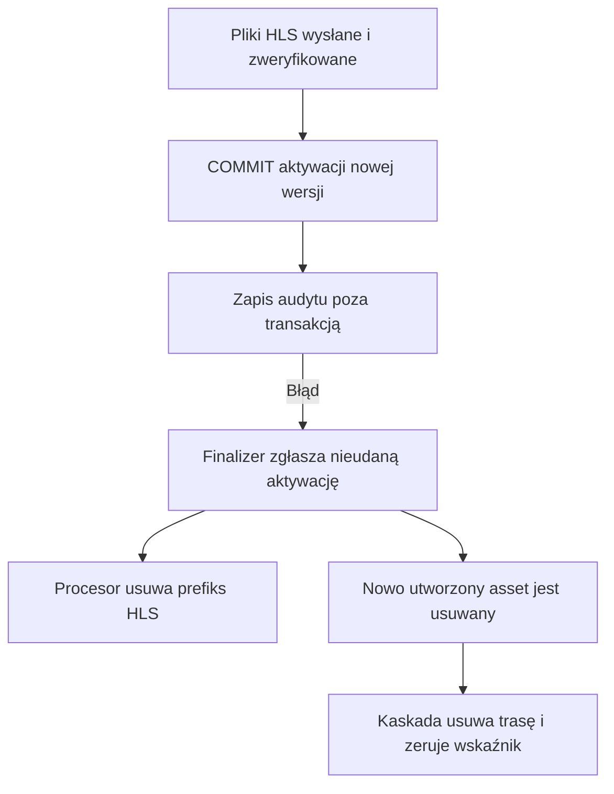

# D08 — upload, kodowanie i usuwanie

1 listopada 2026, partia 06. **W_TRAKCIE.** Kod Polutka: `c397b9e548ca2c628e21457ac69d66e54b12ddbd`. Zakres tej partii: procesor → finalizer → aktywacja trasy → audyt oraz usuwanie pojedynczej wersji HLS. Upload części, jakość FFmpeg i pełny playback pozostają osobnymi otwartymi zakresami.

## Wniosek dla właściciela

Normalna ścieżka kodowania ma sensowną kolejność: wysłanie plików, master na końcu, kontrola obecności/liczby obiektów, dopiero potem aktywacja. Działa też odmowa usunięcia wersji, która już gra opublikowany lub niepubliczny film. Problemem są granice między tymi krokami przy błędzie i nakładaniu się operacji.

**R28, P1:** błąd zapisu audytu po zatwierdzeniu aktywacji uruchamia sprzątanie nowego wyniku. W jednym wariancie znika trasa; w drugim trasa zostaje w bazie, lecz jej pliki są usunięte, a późniejszy retry zgłasza sukces bez sprawdzenia magazynu. **R29, P1 przy współbieżnym zarządzaniu:** sprawdzenie „nie jest używane” starzeje się podczas kasowania; worker może aktywować wersję, którą trwające kasowanie zaraz usunie.

Rozszerzono również dowód istniejącego **R02**: rzeczywisty finalizer i serwis aktywacji wykonują zmianę po zasymulowanej utracie zadania; rzeczywiste repozytorium odrzuca dopiero końcowy zapis statusu starego workera. R02 zachowuje swój numer. R03/R04 nie liczono ponownie jako nowych problemów i nie ponawiano ich identycznych wcześniejszych prób.

## Co dokładnie wykonano

- [Skrypt komponentów](../tools/pipeline-boundaries-experiment.cjs) uruchamia niezmienione moduły TypeScript: procesor, finalizer, serwis tras, kontekst, zapis/repozytorium audytu, repozytorium zadań, cleanup, guard oraz selekcję i kwalifikację assetu. [11 obserwacji i ślady zdarzeń](../evidence/pipeline-boundaries-experiment.json).
- Baza, magazyn i enkoder w tym skrypcie są jawnymi atrapami. Transakcje i kaskady są małym modelem. To nie wygenerowany klient Prisma ani zielony zestaw testów aplikacji. Autoryzację legalnego personelu i wybór kanału założono na jawnych granicach; nie badano obejścia dostępu.
- [Osobny skrypt SQL](../tools/playback-cascade-experiment.py) wykonał trzy protokoły na rzeczywistym lokalnym PostgreSQL 17.11, READ COMMITTED, na dwóch połączeniach. [Wynik](../evidence/playback-cascade-experiment.json) potwierdza COMMIT, kaskadowe usunięcie trasy i wyzerowanie wskaźnika. Nie wywołuje TypeScript/Prisma i nie wstrzykuje rzeczywistej awarii audytu.
- Żaden przebieg nie używał R2, FFmpeg, prawdziwego widza, Next/Server Actions ani produkcji. Efekty magazynu są obserwacją atrapy, a skutki FK osobnym faktem SQL. Łączymy te dowody z przejrzanym kodem; nie opisujemy ich jako jednego pełnego testu stosu.
- Skrypty weryfikują hashe źródeł z inwentarzem bazowym. Katalogi tymczasowe usunięto; fixture SQL mają losowe ID i zostały usunięte. Schemat i triggery pozostały bez zmian.
- Pierwsze uruchomienie komponentów zakończyło się błędem konfiguracji transpileModule: brak interoperacyjności domyślnego importu `node:path`. [Log](../evidence/pipeline-boundaries-initial-harness-error.log) zachowano. Poprawiono wyłącznie konfigurację skryptu badawczego i wykonano całość ponownie z exit 0. Nie klasyfikujemy tego jako błędu aplikacji.

## R28 — błąd po COMMIT uruchamia sprzątanie aktywowanego wyniku

[activateRoute](https://github.com/pawelekbyra/polutek-pl/blob/c397b9e548ca2c628e21457ac69d66e54b12ddbd/lib/modules/video/application/video-playback-route.service.ts#L29) w transakcji zmienia poprzednią trasę na PREVIOUS, tworzy nową ACTIVE, zmienia wskaźnik filmu oraz isPrimary. **Po zatwierdzeniu** zapisuje `VIDEO_PLAYBACK_ROUTE_ACTIVATED` przez zwykłe `recordAuditEvent`. Ten zapis może rzucić błąd.

[Finalizer](https://github.com/pawelekbyra/polutek-pl/blob/c397b9e548ca2c628e21457ac69d66e54b12ddbd/lib/modules/video-pipeline/application/finalize-self-hls.ts#L65) traktuje każdy wyjątek activateRoute jako nieudaną aktywację. Jeżeli sam utworzył asset, usuwa go i ponownie rzuca błąd. Tymczasem [procesor](https://github.com/pawelekbyra/polutek-pl/blob/c397b9e548ca2c628e21457ac69d66e54b12ddbd/lib/modules/video-pipeline/application/process-encode-job.ts#L318) ustawia własne `finalized=true` dopiero po powrocie całego finalizera. Gdy dostaje wyjątek, nadal uważa wynik za nieaktywny i usuwa prefiks HLS.

| Warunek | Obserwacja rzeczywistych komponentów z atrapami |
|---|---|
| Normalny przebieg | SUCCEEDED, nowa trasa aktywna, 5 obiektów wyniku pozostaje |
| Błąd wewnątrz transakcji aktywacji | Rollback; poprzednia trasa ACTIVE i asset primary pozostają; nowy wynik posprzątany |
| Audyt zawodzi po COMMIT, asset utworzony w tej próbie | Nowy asset i trasa usunięte; wskaźnik null, poprzednia trasa PREVIOUS, poprzedni asset isPrimary=false; nowy prefiks pusty |
| Audyt zawodzi po COMMIT, asset pozostał z wcześniejszej próby | Asset i ACTIVE zostają w DB, ale prefiks zostaje pusty |
| Następny retry tego ostatniego wariantu | `findExisting` rozpoznaje READY+ACTIVE i procesor zwraca succeeded; **0 PUT, HEAD, LIST i DELETE**, prefiks nadal pusty |
| Błąd zapisu statusu zadania po pomyślnym powrocie finalizera | Nowa trasa i 5 obiektów pozostają; istniejąca ochrona finalized działa |

Wariant z istniejącym assetem jest osiągalny np. po przerwaniu poprzedniej próby między `videoAsset.create` a aktywacją. `findExisting` nie uzna takiego wiersza za ukończony, jeśli nie ma ACTIVE. Następna finalizacja go wykorzysta, a jej catch nie usuwa wcześniej istniejącego assetu. To tłumaczy różnicę skutków bez założenia przypadkowej kolizji wersji.

Prawdziwy PostgreSQL potwierdził, że usunięcie assetu po COMMIT usuwa jego trasę i ustawia Video.activePlaybackRouteId=null. Poprzednia trasa pozostaje PREVIOUS, a jej asset isPrimary=false. Samą awarię `AuditLog.create` wstrzyknięto na granicy I/O komponentów; nie sprawdzono jej częstości ani wystąpienia na produkcji.

**Wpływ:** możliwość niedostępności nowej wersji i fałszywego stanu sukcesu zadania. Obecny playback ma fallback do wyboru assetu, więc samo null wskaźnika nie wystarcza do wniosku o awarii. Wykonano rzeczywiste helpery selekcji i kwalifikacji: zachowany stary asset zostaje wybrany, ale przy isPrimary=false dostaje NO_PRIMARY_ASSET. W wariancie z zachowaną nową trasą baza kwalifikuje nowy asset jako READY pomimo pustego magazynu. Nie wykonano pełnego PlaybackService, CDN ani odtwarzacza; nie ustalono czasu wpływu na wcześniej zbuforowane odtwarzanie. Oryginalny upload nie jest kasowany tą ścieżką.

**Kierunek poprawy:** rozróżnić nieudane zatwierdzenie od błędu czynności po zatwierdzeniu. Jeśli audyt jest obowiązkowy, rozważyć zapis w tej samej transakcji; jeśli ma być dostarczany później, potrzebny jest trwały mechanizm uzgodnienia. Samo połknięcie błędu audytu traci ślad zdarzenia. Sprzątanie musi znać faktyczną aktywację, a odzyskiwanie nie może uznawać usuniętych obiektów za działający wynik. Nie wdrożono poprawki.

**Odbiór:** pełne komponenty z DB i magazynem testowym, błąd audytu dokładnie po COMMIT, nowy i wcześniej istniejący asset, restart/retry. Poprzednia odtwarzalna wersja lub nowy kompletny wynik pozostają dostępne; system nie zgłasza sukcesu przy pustym prefiksie. Awaria przed COMMIT oraz po powrocie finalizera zachowują dotychczasową poprawną ochronę.

## R29 — sprawdzenie użycia wersji i jej usunięcie mogą się rozminąć

[deleteSelfHlsAsset](https://github.com/pawelekbyra/polutek-pl/blob/c397b9e548ca2c628e21457ac69d66e54b12ddbd/lib/modules/video-pipeline/application/output-cleanup.use-cases.ts#L26) odczytuje film, asset i trasę ACTIVE. Gdy asset nie jest aktywny, przechodzi do `await hls.deletePrefix`, a dopiero potem usuwa wiersz assetu. [Aktywacja](https://github.com/pawelekbyra/polutek-pl/blob/c397b9e548ca2c628e21457ac69d66e54b12ddbd/lib/modules/video/application/video-playback-route.service.ts) nie używa wspólnego z tym usuwaniem mechanizmu rezerwacji/retirement.

Odtworzono następującą kolejność dla już opublikowanego filmu:

1. Istnieje stara aktywna wersja i nowy READY asset bez ACTIVE, np. po utworzeniu przez finalizer przed jego aktywacją.
2. Legalne usuwanie nowej wersji widzi brak jej użycia i rozpoczyna I/O magazynu.
3. W tym oknie rzeczywisty serwis aktywacji wybiera nowy asset: nowa trasa ACTIVE, wskaźnik przestawiony, poprzednia trasa PREVIOUS i isPrimary=false.
4. Usuwanie kontynuuje, kasuje prefiks i asset. Nowa trasa znika przez FK, wskaźnik null; operacja zwraca sukces.

Komponenty wykonano z atrapami, a istotny przeplot odczyt → COMMIT innego połączenia → DELETE odtworzono też bezpośrednio na PostgreSQL. R2 i dwie prawdziwe operacje aplikacji nie zostały wykonane jednocześnie. Jest to konkretny wyścig stanu i skutków, a nie dowiedzione obejście uprawnień.

Kontrole poprawnych granic: aktywna wersja PUBLISHED i UNLISTED dostaje ASSET_IN_USE bez kasowania; nieaktywna wersja usuwana bez konkurencji zachowuje poprzednią ACTIVE; usunięcie aktywnej wersji DRAFT jest dopuszczone zgodnie z komentarzem i regułą produktu. Sam DRAFT nie jest obejściem.

Wejście z UI to [encodeAction, op=delete-asset](https://github.com/pawelekbyra/polutek-pl/blob/c397b9e548ca2c628e21457ac69d66e54b12ddbd/apps/admin/app/%28panel%29/tresci/actions.ts#L233): wymaga personelu i kontekstu panelu. Worker jest osobnym procesem. Nie wykazano, że zwykły widz może uruchomić tę akcję; pełny dispatch i konfigurację produkcyjną pozostawiono otwarte. Potrzebny jest nakładający się wybór dokładnie tego samego assetu; sekwencyjna kontrola działa.

**P1 przed szerszym współbieżnym zarządzaniem treścią.** Kasowanie może uszkodzić właśnie aktywowany wynik i nie przywraca poprzedniej trasy. Nie wykazano utraty oryginału ani problemu każdego kasowania.

**Kierunek poprawy i odbiór:** aktywacja i usuwanie potrzebują wspólnej decyzji o cyklu życia zasobu. Sam drugi SELECT przed DELETE zostawia następne okno wyścigu; sam lock SQL zwalniany przed I/O również. Rozważyć oznaczenie wersji jako wycofywanej pod wspólną blokadą, odmowę jej aktywacji i trwałe sprzątanie po tej decyzji. Przetestować oba porządki operacji, przerwanie magazynu i procesu oraz przypadki PUBLISHED/UNLISTED/DRAFT. Nie wdrożono nowego protokołu.

## R02 — mocniejszy dowód, ten sam problem

W nowym przebiegu zasymulowano zmianę właściciela zadania A→B po ostatniej kontroli stanu i podczas weryfikacji wyjścia. Rzeczywisty procesor wywołał rzeczywisty finalizer, activateRoute i recordAuditEvent. Zmiana aktywnej trasy nastąpiła. Rzeczywisty `EncodeJobRepository.markSucceeded` odrzucił zapis A po workerId, więc wynik procesora był lost, a zadanie pozostało RUNNING dla B.

To potwierdza różnicę między ochroną wiersza zadania a ochroną skutku aktywacji. Własność zasymulowano w atrapie DB; nie przeprowadzono realnego requeue z czasem dzierżawy ani dwóch procesów encoder. Historyczny eksperyment kasowania prefiksu po utracie zadania pozostaje osobnym wcześniejszym dowodem. Niezależny przegląd nadal PENDING.

## PeerTube i otwarty zakres

W przypiętej wersji PeerTube przejrzano [AbstractJobHandler.complete](https://github.com/Chocobozzz/PeerTube/blob/fa7d2b5d8a44bbec99159b11e91763f7d2308faa/server/core/lib/runners/job-handlers/abstract-job-handler.ts#L151), [pending-completions](https://github.com/Chocobozzz/PeerTube/blob/fa7d2b5d8a44bbec99159b11e91763f7d2308faa/server/core/lib/runners/job-handlers/shared/pending-completions.ts) i callback przed nieodwracalnymi zmianami w [video-studio handler](https://github.com/Chocobozzz/PeerTube/blob/fa7d2b5d8a44bbec99159b11e91763f7d2308faa/server/core/lib/runners/job-handlers/video-studio-transcoding-job-handler.ts#L148). Modelują COMPLETING, przerwanie i punkt, po którym nie wolno oddać pracy do ponownego wykonania. Stan pending-completions jest lokalną mapą procesu; nie jest sam w sobie rozproszoną blokadą wszystkich skutków.

To użyteczny wzorzec rozdzielenia faz. Nie testowano PeerTube, odpowiednika awarii audytu ani identycznego wyścigu usuwania; nie przypisujemy mu automatycznie odporności na R28/R29. Nie kopiowano implementacji.

Do zamknięcia D08 pozostają m.in. multipart i porzucone części, walidacja złośliwych plików/FFmpeg, matryca formatów, HDR/FPS/audio i jakość obrazu, realne R2 i awarie sieci, pełne restarty/takeover, utrata odpowiedzi po sukcesie, stare oryginały w kolejce, quota/koszt i retencja. D09 musi objąć pełne plany odtwarzania, cofanie dostępu, cache/tokeny i urządzenia. Wszystkie 11 [scenariuszy pipeline](../SCENARIUSZE-PIPELINE.csv) mają nadal otwartą walidację pełnego stosu.
